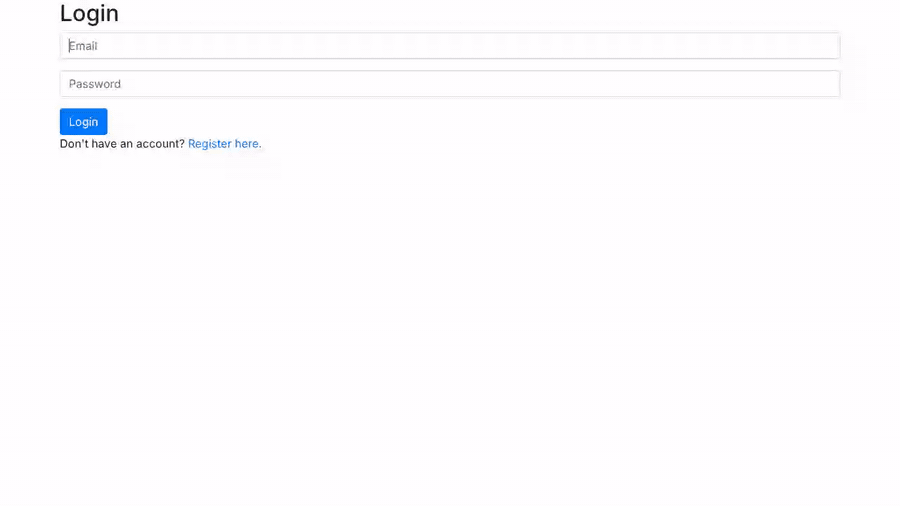

# Mail

A single-page email client that runs in the browser. It talks to a Django JSON API to show the inbox, sent and archived mailboxes, open and reply to emails, archive them and send new ones, all without reloading the page. This was Project 3 ("Mail") of Harvard's CS50 Web Programming with Python and JavaScript course.



The demo was recorded on a local copy with sample accounts. An earlier video walkthrough is also on [YouTube](https://youtu.be/kHId4vC-BOc).

## Features

- **Mailboxes:** Inbox, Sent and Archived, each listing the sender, subject and time, newest first. Unread emails have a white background and read emails a gray one.
- **Reading an email:** clicking an email shows its sender, recipients, subject, time and body, and marks it as read.
- **Replying:** the Reply button opens the compose form with the recipient filled in, the subject starting with "Re: " and the original message quoted in the body ("On <date> <sender> wrote: ...").
- **Archiving:** inbox emails have an Archive button and archived emails an Unarchive button. Both return you to the inbox.
- **Composing:** send an email to one or more users (separate addresses with commas).
- **Accounts:** register with an email address and password, then log in. The emails only go between users of this app; nothing is sent over the real internet.

## How it works

1. The Django back end provides a small JSON API:
   - `GET /emails/<mailbox>` returns the emails in `inbox`, `sent` or `archive`.
   - `GET /emails/<id>` returns one email; `PUT /emails/<id>` updates its `read` or `archived` flag.
   - `POST /emails` sends an email. The server saves one copy for the sender and one for each recipient, so each user can mark their own copy as read or archived.
2. `inbox.html` is the only page after logging in. `inbox.js` shows and hides the mailbox, email and compose views and builds the email list from the API's JSON with `fetch`.

The Django back end (models, API views and login/register pages) came with the course's starter code. My work was the front end in `mail/static/mail/inbox.js`, along with the styles.

## Project structure

```
project3/                 Django project settings and URLs
mail/                     The app
├── models.py             User and Email models
├── views.py              JSON API and login/register views
├── urls.py               Page and API routes
├── templates/mail/       layout, inbox (the single page), login and register
└── static/mail/
    ├── inbox.js          The single-page front end
    └── styles.css
```

## Running it locally

The migrations were made with Django 3.1.3. I tested it with **Python 3.9** and Django 3.1.3.

```bash
python3.9 -m venv venv
source venv/bin/activate
pip install Django==3.1.3
python manage.py migrate
python manage.py runserver
```

Then open http://127.0.0.1:8000 and register an account. To send emails between users, register a second account (for example in a private window) and use its address as the recipient.

The pages load Bootstrap from a public CDN, so they need an internet connection to look right.

## Built with

- **Backend:** Python, Django 3.1, SQLite
- **Frontend:** JavaScript (`fetch`), HTML, CSS and Bootstrap 4

## Course credit

This project was built for [CS50's Web Programming with Python and JavaScript](https://cs50.harvard.edu/web/2020/) from Harvard University. The project description is [here](https://cs50.harvard.edu/web/2020/projects/3/mail/).

Created by Sangye Tenphel, 2021.
